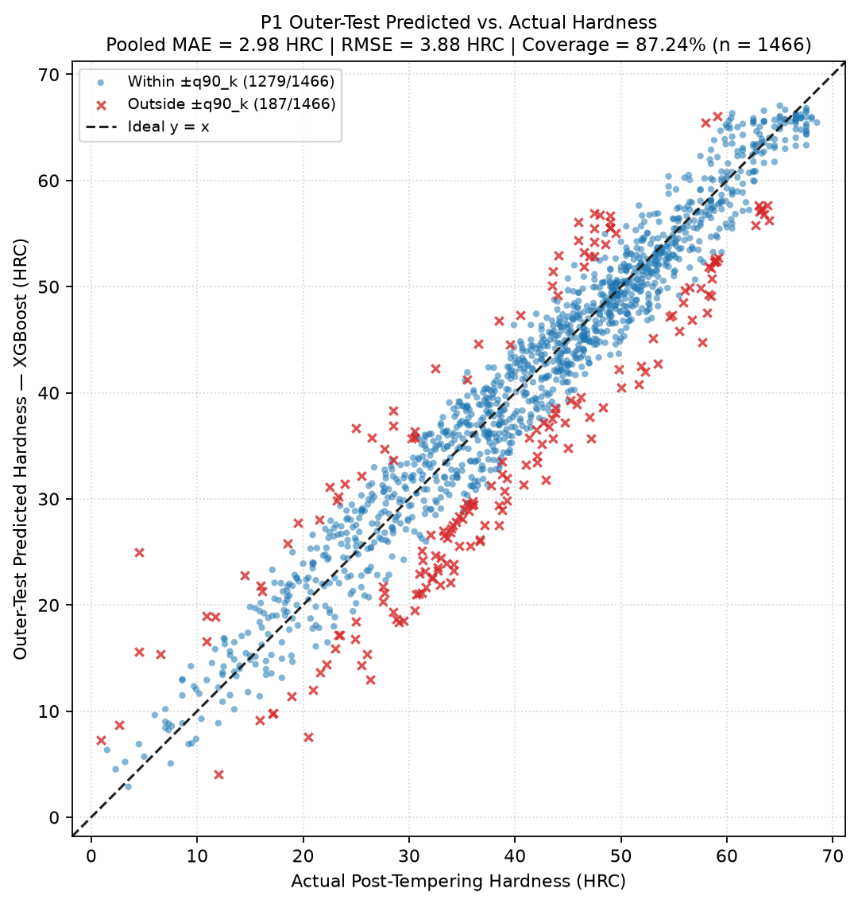
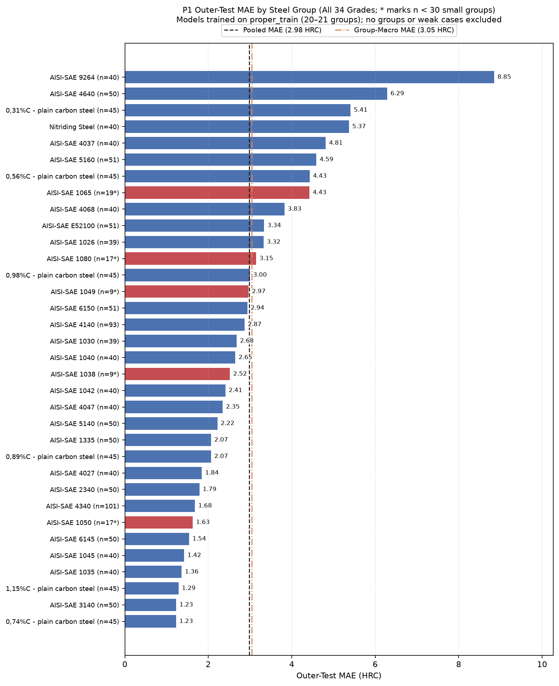
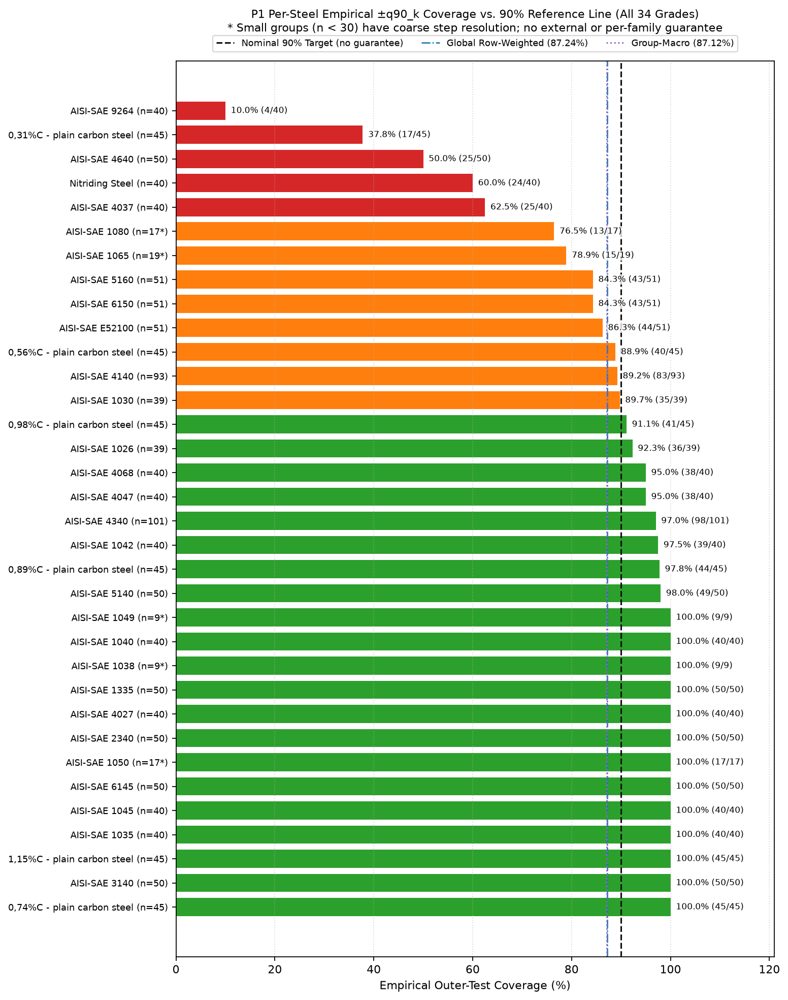

# P1 Grouped Evaluation Report (Held-Out Calibration Benchmark)

> **Scope & Limitations Notice:** This report summarizes the completed P1 unbiased grouped evaluation (`outer GroupKFold(5)` with target-blind `proper_train` / `calibration` separation at `seed=42`). These metrics characterize `proper_train`-fitted models (`20–21` groups per fold) within the 3 literature compilations; **there is no independent external dataset and no theoretical 90% coverage guarantee for unseen steel groups**. The interactive demo/API (`app.py`, `api.py`) continues to serve legacy pre-built `models/` artifacts (`artifact_meta.json`, `q90 = 4.9673 HRC`), **not** models from this P1 benchmark.

## 1. Aggregate Benchmark Comparison

| Model | Fold-Mean MAE ± Std (HRC) | Pooled Row-Weighted MAE (`n=1466`) | Pooled RMSE | Pooled R² | Group-Macro MAE ± Std (`G=34`) |
| :--- | :---: | :---: | :---: | :---: | :---: |
| **B1_Naive** (`DummyRegressor` median) | `11.5008 ± 0.6353` | `11.4993` | `14.3426` | `-0.0385` | `11.6793 ± 2.5711` |
| **B2_Physics** (`LinearRegression` on `p_hj`) | `4.6867 ± 1.2491` | `4.6943` | `5.8927` | `0.8247` | `4.7513 ± 2.5639` |
| **XGBoost (P1)** (`3-fold` inner × `20` cand.) | **`2.9838 ± 0.6322`** | **`2.9842`** | **`3.8800`** | **`0.9240`** | **`3.0450 ± 1.6607`** |

- **Uncertainty Band Summary (`outer_test`):** Global row-weighted empirical coverage = **`87.24%`** (`1279/1466`); Fold-mean coverage = **`87.28% ± 5.01%`**; Group-macro coverage (`34` grades equally weighted) = **`87.12% ± 20.35%`**. Fold-mean `q90_k` = `5.7217 HRC`, mean full band width = **`11.4433 HRC`** (`11.4343 HRC` row-weighted).
- **Comparison with Historical `V2-C2` Scores (`2.35` fold-mean / `2.48` pooled MAE):** Higher P1 error (`~+0.50` to `+0.63 HRC`) reflects both removal of selection/calibration overlap **and** structural changes in P1—holding out `7` calibration groups shrinks training data from `27–28` groups (`~80%`) to `20–21` groups (`~60%`), alongside a `3`-fold × `20`-candidate inner search budget. The gap must therefore **not** be attributed solely to historical evaluation optimism.

## 2. Per-Fold Metrics & Held-Out Calibration (`q90_k`)

| Fold | `n_test` (`groups`) | XGB MAE (HRC) | XGB RMSE | XGB R² | `B2_Physics` MAE | `n_cal` | `q90_k` (HRC) | Width (`2×q90_k`) | Coverage |
| :---: | :---: | :---: | :---: | :---: | :---: | :---: | :---: | :---: | :---: |
| 0 | 293 (7) | 2.4919 | 3.1883 | 0.9372 | 7.0471 | 285 | 5.0305 | 10.0610 | 88.05% |
| 1 | 307 (6) | 3.1323 | 4.2242 | 0.9116 | 4.6858 | 285 | 5.4906 | 10.9811 | 83.71% |
| 2 | 290 (7) | 3.0991 | 3.8297 | 0.9113 | 4.3895 | 302 | 6.3418 | 12.6836 | 89.66% |
| 3 | 288 (7) | 2.1772 | 2.7106 | 0.9643 | 3.5687 | 282 | 5.1906 | 10.3813 | 94.79% |
| 4 | 288 (7) | 4.0184 | 5.0152 | 0.8884 | 3.7425 | 284 | 6.5549 | 13.1097 | 80.21% |

## 3. Visualizations







## 4. Per-Steel Breakdown (All 34 Grades; No Cases Excluded)

| Steel Grade | Fold | `n` | XGB MAE | XGB RMSE | XGB Bias | `B2` MAE | `q90_k` | Coverage (`hit/n`) |
| :--- | :---: | :---: | :---: | :---: | :---: | :---: | :---: | :---: |
| `AISI-SAE 9264` | 1 | 40 | 8.851 | 9.205 | -8.851 | 8.228 | 5.491 | 10.0% (4/40) |
| `AISI-SAE 4640` | 4 | 50 | 6.286 | 7.020 | -6.286 | 2.048 | 6.555 | 50.0% (25/50) |
| `0,31%C - plain carbon steel` | 0 | 45 | 5.408 | 5.857 | +5.380 | 13.036 | 5.030 | 37.8% (17/45) |
| `Nitriding Steel` | 2 | 40 | 5.369 | 5.631 | -5.369 | 6.219 | 6.342 | 60.0% (24/40) |
| `AISI-SAE 4037` | 4 | 40 | 4.815 | 5.565 | -4.815 | 2.593 | 6.555 | 62.5% (25/40) |
| `AISI-SAE 5160` | 4 | 51 | 4.591 | 5.120 | +4.053 | 4.395 | 6.555 | 84.3% (43/51) |
| `0,56%C - plain carbon steel` | 4 | 45 | 4.431 | 4.770 | +4.431 | 2.496 | 6.555 | 88.9% (40/45) |
| `AISI-SAE 1065` * | 2 | 19 | 4.425 | 4.766 | -4.367 | 2.777 | 6.342 | 78.9% (15/19) |
| `AISI-SAE 4068` | 2 | 40 | 3.825 | 4.116 | -3.825 | 4.727 | 6.342 | 95.0% (38/40) |
| `AISI-SAE E52100` | 2 | 51 | 3.337 | 4.352 | -2.864 | 6.132 | 6.342 | 86.3% (44/51) |
| `AISI-SAE 1026` | 1 | 39 | 3.323 | 3.644 | +3.323 | 9.574 | 5.491 | 92.3% (36/39) |
| `AISI-SAE 1080` * | 3 | 17 | 3.148 | 3.625 | -3.074 | 5.149 | 5.191 | 76.5% (13/17) |
| `0,98%C - plain carbon steel` | 4 | 45 | 2.997 | 4.726 | +1.906 | 4.675 | 6.555 | 91.1% (41/45) |
| `AISI-SAE 1049` * | 0 | 9 | 2.966 | 3.083 | +2.966 | 3.713 | 5.030 | 100.0% (9/9) |
| `AISI-SAE 6150` | 3 | 51 | 2.937 | 3.571 | -1.944 | 3.961 | 5.191 | 84.3% (43/51) |
| `AISI-SAE 4140` | 1 | 93 | 2.868 | 3.425 | -2.119 | 3.595 | 5.491 | 89.2% (83/93) |
| `AISI-SAE 1030` | 0 | 39 | 2.682 | 3.299 | +2.666 | 10.882 | 5.030 | 89.7% (35/39) |
| `AISI-SAE 1040` | 3 | 40 | 2.647 | 3.035 | +1.493 | 4.340 | 5.191 | 100.0% (40/40) |
| `AISI-SAE 1038` * | 0 | 9 | 2.519 | 2.597 | +2.519 | 6.335 | 5.030 | 100.0% (9/9) |
| `AISI-SAE 1042` | 2 | 40 | 2.409 | 2.918 | +1.880 | 3.330 | 6.342 | 97.5% (39/40) |
| `AISI-SAE 4047` | 3 | 40 | 2.345 | 2.822 | -2.016 | 2.250 | 5.191 | 95.0% (38/40) |
| `AISI-SAE 5140` | 3 | 50 | 2.219 | 2.622 | +1.574 | 2.289 | 5.191 | 98.0% (49/50) |
| `AISI-SAE 1335` | 2 | 50 | 2.066 | 2.465 | +1.762 | 2.641 | 6.342 | 100.0% (50/50) |
| `0,89%C - plain carbon steel` | 1 | 45 | 2.065 | 2.403 | -1.975 | 4.132 | 5.491 | 97.8% (44/45) |
| `AISI-SAE 4027` | 0 | 40 | 1.844 | 2.128 | +1.725 | 6.502 | 5.030 | 100.0% (40/40) |
| `AISI-SAE 2340` | 0 | 50 | 1.788 | 2.064 | +1.766 | 4.925 | 5.030 | 100.0% (50/50) |
| `AISI-SAE 4340` | 0 | 101 | 1.680 | 2.157 | -0.078 | 4.525 | 5.030 | 97.0% (98/101) |
| `AISI-SAE 1050` * | 4 | 17 | 1.627 | 1.902 | -1.120 | 1.738 | 6.555 | 100.0% (17/17) |
| `AISI-SAE 6145` | 2 | 50 | 1.541 | 2.303 | -1.282 | 4.088 | 6.342 | 100.0% (50/50) |
| `AISI-SAE 1045` | 1 | 40 | 1.422 | 1.727 | +0.944 | 2.733 | 5.491 | 100.0% (40/40) |
| `AISI-SAE 1035` | 4 | 40 | 1.359 | 1.683 | -1.178 | 7.383 | 6.555 | 100.0% (40/40) |
| `1,15%C - plain carbon steel` | 3 | 45 | 1.287 | 1.608 | +0.260 | 3.795 | 5.191 | 100.0% (45/45) |
| `AISI-SAE 3140` | 1 | 50 | 1.229 | 1.418 | -1.189 | 2.128 | 5.491 | 100.0% (50/50) |
| `0,74%C - plain carbon steel` | 3 | 45 | 1.227 | 1.454 | -0.558 | 4.209 | 5.191 | 100.0% (45/45) |

*(Asterisk `*` marks small groups with `n < 30`; single-row shifts in `n = 9–19` groups change empirical coverage by `5.3–11.1` percentage points, so strong conclusions should not be drawn from small groups alone.)*

## 5. Provenance, Sharing Scope & Reproducibility

- **Dataset SHA-256 (verified local raw CSV):** `3f88fdccf4bb2f3c03be6eeca03001b4bd8a2b0de5cd4818195486182a4762b0`
- **Evaluation Code Commit:** `eeee8e884551573bdebd59a67d4fb40f1235790c` | **Fit Counts:** `{'xgb_fits': 305, 'baseline_fits': 10, 'total_fits': 315}` | **Elapsed Time:** `53.563 s`
- **Sharing Policy for Per-Row Outputs & Manifests (Why `predictions.csv` / `split_manifest.json` / `run_manifest.json` Are Omitted Here):**
  - Excluding `data/raw/` via `.gitignore` is a repository workflow practice, **not** a license determination or legal sharing ban; similarly, row-index lists in `split_manifest.json` are not confidential or inherently prohibited.
  - General redistribution with attribution under `CC BY 4.0` (the Kaggle dataset license) is distinct from verifying what underlying rights the dataset uploader holds over the compiled historical literature sources (`Hollomon & Jaffe 1945`, `Grange & Baughman 1956`, and ambiguous `Penha 2010`).
  - Because committing per-row Kaggle target outputs (`predictions.csv`), raw split indices (`split_manifest.json`), or local OS runtime dumps (`run_manifest.json`) is not required for this publication package, source provenance over underlying compilations has not been separately cleared, and every omitted file is deterministically reproducible locally (`seed=42`), those three files remain outside Git.
- **1. Full Reproduction From a Clean GitHub Clone (Requires External Source Dataset):**
  A clean GitHub clone alone does **not** include the raw CSV or local P1 run outputs; you must first obtain the dataset independently, verify its SHA-256 checksum, run `p1_evaluation`, and then run `p1_reporting`:
```bash
# 1. Place the Raiipa CSV at data/raw/ and verify its SHA-256 matches:
#    3f88fdccf4bb2f3c03be6eeca03001b4bd8a2b0de5cd4818195486182a4762b0
python -c "import hashlib; print(hashlib.sha256(open('data/raw/Tempering data for carbon and low alloy steels - Raiipa.csv', 'rb').read()).hexdigest())"
# 2. Run the full P1 evaluation (writes predictions.csv & manifests outside models/):
python -m materials_data_lab.p1_evaluation --csv "data/raw/Tempering data for carbon and low alloy steels - Raiipa.csv" --outdir <local_p1_run_dir> --mode full --max-seconds 900
# 3. Generate summary.json, technical report, and PNG plots from that run:
python -m materials_data_lab.p1_reporting --input-dir <local_p1_run_dir> --outdir reports/p1_grouped_evaluation
```
- **2. Regenerate Report & Charts Only From an Existing Local Run Directory (No Training or CSV Access):**
```bash
python -m materials_data_lab.p1_reporting --input-dir <local_p1_run_dir> --outdir reports/p1_grouped_evaluation
```
